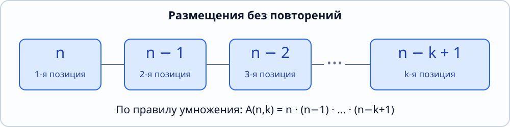
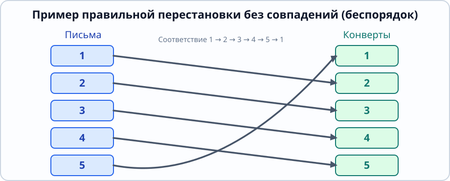

[[Модуль II — Теория вероятностей|← Модуль II]] · [[База знаний|Главное оглавление]]

# Модуль II. Теория вероятностей

## Лекция 1 (12.10.2026). Элементы комбинаторики

> [!important] Сверка с источниками
> **Рукописная лекция:** Тервер1.pdf, 4 страницы, 12.10.2026. Исходный PDF пока находится во вложениях проекта; для прямых ссылок вида sources/Тервер1.pdf#page=N его ещё нужно добавить в GitHub-репозиторий.
>
> **Профильный учебник (внешний, не один из ранее прикреплённых):** Оскар Левин, *Discrete Mathematics: An Open Introduction*, 4-е издание:
> - [§3.2. Правила сложения и умножения](https://discrete.openmathbooks.org/dmoi4/sec_counting-combine-outcomes.html)
> - [§3.4. Перестановки, размещения и сочетания](https://discrete.openmathbooks.org/dmoi4/sec_counting-combperm.html)
> - [§3.3. Принцип включений–исключений](https://discrete.openmathbooks.org/dmoi4/sec_counting-non-disjoint.html)
> - [§3.8. Беспорядки и включения–исключения](https://discrete.openmathbooks.org/dmoi4/sec_advPIE.html)
>
> Прикреплённые прежде Власова, Воробьёв, Гаврилов и Демидович не являются профильными учебниками этого нового модуля. Здесь доказательства согласованы с указанными разделами открытого учебника; это **не утверждение о сверке с отсутствующим учебником по теории вероятностей**.

## Содержание

- [1. Конечное множество и мощность](#1-конечное-множество-и-мощность)
- [2. Упорядоченная и неупорядоченная выборка](#2-упорядоченная-и-неупорядоченная-выборка)
- [3. Правило умножения](#3-правило-умножения)
- [4. Размещения без повторений](#4-размещения-без-повторений)
- [5. Перестановки без повторений](#5-перестановки-без-повторений)
- [6. Сочетания без повторений](#6-сочетания-без-повторений)
- [7. Как различать формулы](#7-как-различать-формулы)
- [8. Принцип включений–исключений](#8-принцип-включений–исключений)
- [9. Беспорядки — перестановки без неподвижных точек](#9-беспорядки--перестановки-без-неподвижных-точек)
- [10. Пример из лекции: пять писем и пять конвертов](#10-пример-из-лекции-пять-писем-и-пять-конвертов)
- [11. Что не рассматривалось на этой лекции](#11-что-не-рассматривалось-на-этой-лекции)

## 1. Конечное множество и мощность

> **Лекция:** стр. 1. **Учебник:** Левин, §3.4.

Пусть дано конечное множество из $n$ попарно различных элементов:

$$
M=\{a_1,a_2,\ldots,a_n\}.
$$

Число его элементов (мощность) обозначается

$$
|M|=n.
$$

Число $k$ в первой лекции — **количество выбираемых элементов**. Для выборок без повторений рассматривается $0\le k\le n$.

Если $N\subseteq M$ и

$$
|N|=k,
$$

то $N$ называется **$k$-элементным подмножеством** множества $M$.

При выборе необходимо различать два объекта: множество выбранных элементов и последовательность их выбора.

## 2. Упорядоченная и неупорядоченная выборка

> **Лекция:** стр. 1. **Учебник:** Левин, §3.4, подразделы *Counting Sequences*, *Counting Sets*.

**Упорядоченная выборка** длины $k$ без повторений — это кортеж

$$
(a_{i_1},a_{i_2},\ldots,a_{i_k}),
$$

где индексы $i_1,\ldots,i_k$ попарно различны. Порядок имеет значение:

$$
(a_1,a_2)\ne(a_2,a_1).
$$

**Неупорядоченная выборка** из $k$ элементов — это подмножество

$$
N=\{a_{i_1},a_{i_2},\ldots,a_{i_k}\},\qquad |N|=k.
$$

Здесь порядок записи несущественен:

$$
\{a_1,a_2\}=\{a_2,a_1\}.
$$

> [!note] Важное различие
> Для сочетания результат — **множество**; для размещения результат — **упорядоченная последовательность различных элементов**. Запись через фигурные скобки и через круглые скобки означает разные математические объекты.

## 3. Правило умножения

> **Лекция:** стр. 3. **Учебник:** [Левин, §3.2](https://discrete.openmathbooks.org/dmoi4/sec_counting-combine-outcomes.html).

### Формулировка

Если первый этап действия может быть выполнен $n$ способами, а при каждом выборе первого этапа второй этап — $m$ способами, то двухэтапное действие можно выполнить

$$
\boxed{n\cdot m}
$$

способами.

В языке множеств при конечных $A$ и $B$:

$$
\boxed{|A\times B|=|A|\cdot|B|}.
$$

**Доказательство.** Для каждого из $n$ элементов множества $A$ имеется ровно $m$ пар вида $(a,b)$ с $b\in B$. Эти группы пар попарно не пересекаются. Поэтому общее число пар равно $nm$.

Для $r$ последовательных этапов, когда количество вариантов на $j$-м этапе равно $n_j$ и не зависит от того, как выполнены предыдущие этапы,

$$
N=n_1n_2\cdots n_r.
$$

На этом принципе основаны формулы размещений и перестановок.

## 4. Размещения без повторений

> **Лекция:** стр. 1–2, формула (2) и доказательство. **Учебник:** Левин, §3.4, теорема о $k$-перестановках.

**Определение.** Размещением из $n$ по $k$ без повторений называется упорядоченный набор $k$ различных элементов из $n$.

Число размещений обозначают $A_n^k$:

$$
\boxed{
A_n^k=n(n-1)\cdots(n-k+1)=\frac{n!}{(n-k)!}
}.
$$

### Доказательство

Первый элемент можно выбрать $n$ способами, второй — $n-1$ способом, третий — $n-2$ способами. Так как элементы не повторяются, для $k$-й позиции останется $n-k+1$ вариантов. По правилу умножения

$$
A_n^k=n(n-1)\cdots(n-k+1).
$$

Умножим и разделим на $(n-k)!$:

$$
A_n^k
=
\frac{n(n-1)\cdots(n-k+1)(n-k)!}{(n-k)!}
=
\frac{n!}{(n-k)!}.
$$

*Рис. 11. Число доступных вариантов для последовательного выбора без повторений убывает: $n$, $n-1$, $n-2$, ..., $n-k+1$.*

**Пример.** Из пяти разных предметов выбрать три и расположить их в ряд:

$$
A_5^3=5\cdot4\cdot3=60.
$$

## 5. Перестановки без повторений

> **Лекция:** стр. 1–2, формула (3). **Учебник:** Левин, §3.4, теорема о перестановках.

**Определение.** Перестановка — размещение всех $n$ различных элементов, то есть размещение при $k=n$.

Число перестановок:

$$
\boxed{P_n=n!}.
$$

### Доказательство

Перестановка — частный случай размещения при $k=n$. Поэтому

$$
P_n=A_n^n=\frac{n!}{(n-n)!}=\frac{n!}{0!}=n!,
$$

где по соглашению

$$
0!=1.
$$

**Пример.** Пять разных книг можно расставить на полке $5!=120$ способами.

## 6. Сочетания без повторений

> **Лекция:** стр. 1–3, формула (1) и доказательство на доске. **Учебник:** Левин, §3.4, *Counting Sets* и *The Quotient Principle*.

**Определение.** Сочетанием из $n$ по $k$ называется неупорядоченное $k$-элементное подмножество $n$-элементного множества.

Число сочетаний:

$$
\boxed{
C_n^k=\binom nk=\frac{n!}{k!(n-k)!}
}.
$$

### Доказательство

Сначала выберем $k$ элементов **без учёта порядка** — это можно сделать $C_n^k$ способами.

Каждое выбранное $k$-элементное множество можно упорядочить $k!$ способами. Так мы получим все размещения без повторений длины $k$, причём каждое ровно один раз.

По правилу умножения

$$
A_n^k=C_n^k\cdot k!.
$$

Следовательно,

$$
C_n^k=\frac{A_n^k}{k!}
=\frac{n!}{k!(n-k)!}.
$$

**Пример.** Выбрать три предмета из пяти без учёта порядка:

$$
C_5^3=\frac{5!}{3!\,2!}=10.
$$

**Соглашения и полезные свойства:**

$$
C_n^0=C_n^n=1,\qquad C_n^k=C_n^{n-k}.
$$

Симметрия вытекает из того, что выбор $k$ элементов однозначно определяет выбор оставшихся $n-k$.

## 7. Как различать формулы

| Вопрос | Порядок важен? | Сколько элементов выбираем? | Формула |
|---|---|---|---|
| Выбрать $k$ из $n$ | Нет | $k$ | $C_n^k$ |
| Выбрать $k$ из $n$ и расположить | Да | $k$ | $A_n^k$ |
| Расставить все $n$ | Да | $n$ | $P_n=n!$ |

Все три формулы выше относятся **только к выбору без повторений**. Случай повторений в этой лекции не разобран и сюда не добавлен как якобы пройденный материал.

Для одной и той же пятёрки различных элементов при $k=3$:

$$
C_5^3=10,\qquad A_5^3=60,\qquad P_5=120.
$$

## 8. Принцип включений–исключений

> **Лекция:** стр. 3–4, формула в конце стр. 3. **Учебник:** [Левин, §3.3](https://discrete.openmathbooks.org/dmoi4/sec_counting-non-disjoint.html), [§3.8](https://discrete.openmathbooks.org/dmoi4/sec_advPIE.html).

Пусть $A_1,\ldots,A_n$ — конечные множества. Если просто сложить их мощности, общие элементы окажутся посчитаны несколько раз. Чтобы устранить повторный подсчёт, попарные пересечения вычитают, тройные добавляют обратно и т. д.

Для двух множеств:

$$
|A\cup B|=|A|+|B|-|A\cap B|.
$$

Для трёх:

$$
\begin{aligned}
|A\cup B\cup C|
={}&|A|+|B|+|C|\\
&-|A\cap B|-|A\cap C|-|B\cap C|\\
&+|A\cap B\cap C|.
\end{aligned}
$$

Для произвольного $n$:

$$
\boxed{
\left|\bigcup_{i=1}^n A_i\right|
=
\sum_{\varnothing\ne I\subseteq\{1,\ldots,n\}}
(-1)^{|I|+1}
\left|\bigcap_{i\in I}A_i\right|
}.
$$

### Идея доказательства

Зафиксируем элемент $x$, который принадлежит ровно $r\ge1$ множествам из $A_1,\ldots,A_n$. В правой части формулы этот элемент учитывается с коэффициентом

$$
\binom r1-\binom r2+\binom r3-\cdots+(-1)^{r+1}\binom rr.
$$

Из биномиальной формулы

$$
(1-1)^r
=
\sum_{j=0}^{r}(-1)^j\binom rj=0
$$

следует, что данный коэффициент равен единице. Элемент, который не входит ни в одно множество, не учитывается. Значит, правая часть считает каждый элемент объединения ровно один раз.

> [!important]
> В задаче об отсутствии «совпадений» удобно сначала подсчитать **все** допустимые распределения, затем вычесть объединение множеств «нежелательных совпадений» по формуле включений–исключений.

## 9. Беспорядки — перестановки без неподвижных точек

> **Лекция:** стр. 3–4. **Учебник:** [Левин, §3.8, подраздел Counting Derangements](https://discrete.openmathbooks.org/dmoi4/sec_advPIE.html).

**Определение.** Беспорядок (*derangement*) порядка $n$ — перестановка

$$
\pi:\{1,\ldots,n\}\to\{1,\ldots,n\},
$$

для которой ни один элемент не остаётся на своём месте:

$$
\pi(i)\ne i
\quad\text{для всех }i=1,\ldots,n.
$$

Число беспорядков обозначим $D_n$.

### Формула и доказательство

Всего существует $n!$ перестановок.

Пусть $A_i$ — множество перестановок, в которых элемент $i$ остался на месте. Тогда

$$
|A_i|=(n-1)!.
$$

Если на месте остаются любые заранее выбранные $j$ элементов, оставшиеся $n-j$ элементов можно переставить $(n-j)!$ способами. Набор фиксируемых позиций выбирается $\binom nj$ способами.

Применим принцип включений–исключений к дополнению объединения $A_1\cup\cdots\cup A_n$:

$$
\begin{aligned}
D_n
={}&n!-\binom n1(n-1)!
+\binom n2(n-2)!\\
&-\binom n3(n-3)!
+\cdots+(-1)^n\binom nn0!.
\end{aligned}
$$

Поскольку

$$
\binom nj(n-j)!=\frac{n!}{j!},
$$

получаем

$$
\boxed{
D_n=n!\sum_{j=0}^n\frac{(-1)^j}{j!}
}.
$$

Это **законченная теорема**, которая в лекции приведена через конкретный пример с пятью предметами.

*Рис. 12. В допустимом беспорядке письмо с номером $i$ не должно оказаться в конверте с тем же номером.*

## 10. Пример из лекции: пять писем и пять конвертов

> **Лекция:** стр. 3–4. **Учебник:** Левин, §3.8, пример о пяти людях и шляпах, математически эквивалентный задаче о письмах и конвертах.

**Условие.** Есть пять различных писем и пять конвертов с соответствующими адресатами. Каждое письмо помещается в отдельный конверт. Сколькими способами можно разложить письма так, чтобы **ни одно письмо не оказалось в своём конверте**?

Все возможные размещения писем по конвертам — перестановки пяти элементов, то есть

$$
5!=120.
$$

Обозначим через $A_i$ множество размещений, в которых $i$-е письмо лежит в своём конверте. Тогда

$$
|A_i|=4!,
\qquad
|A_i\cap A_j|=3!\quad(i\ne j),
$$

а вообще, если $j$ выбранных писем лежат правильно, число допустимых размещений остальных писем равно $(5-j)!$.

По принципу включений–исключений искомое число:

$$
\begin{aligned}
D_5
={}&5!-\binom51 4!
+\binom52 3!
-\binom53 2!\\
&+\binom54 1!-\binom55 0!\\
={}&120-120+60-20+5-1\\
={}&\boxed{44}.
\end{aligned}
$$

**Ответ:** 44 способа.

> [!note] На что обратить внимание
> Вся формула работает потому, что **каждый конверт получает ровно одно письмо**. Если разрешить несколько писем в одном конверте, то это уже не перестановки, и данная формула будет неприменима.

### Обобщение

Для $n$ писем и $n$ конвертов:

$$
D_n=n!\left(
1-\frac1{1!}+\frac1{2!}
-\cdots+\frac{(-1)^n}{n!}
\right).
$$

## 11. Что не рассматривалось на этой лекции

На страницах 1–4 **ещё нет** определения случайного эксперимента, пространства элементарных исходов, события, вероятности, аксиом Колмогорова или формулы условной вероятности.

Комбинаторика является подготовительным блоком нового модуля. Эти темы следует добавлять по следующим лекциям, а не приписывать первой лекции заранее.

---

[[Модуль II — Теория вероятностей|← Модуль II]] · [[База знаний|Главное оглавление]]
