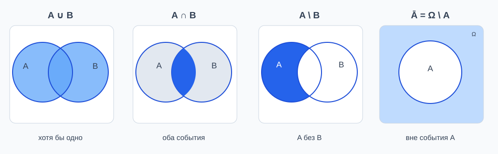
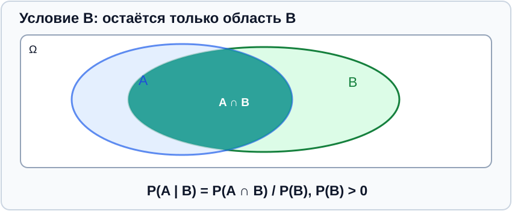
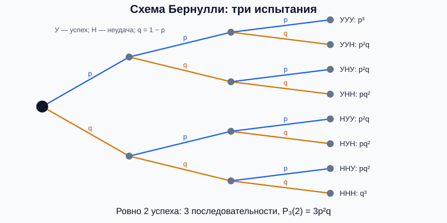

[[Модуль II — Теория вероятностей|← Модуль II]] · [[07 — Комбинаторика|← Лекция 1]] · [[База знаний|Главное оглавление]]

# Лекция 2. Случайные события, вероятность и схема Бернулли

> [!important] Первоисточники и статус
> **Рукописная лекция:** «Тервер2.pdf», 8 страниц, на первом листе дата 19.10.2026. Просмотрены также фотографии доски на стр. 2–8.
>
> **Приоритетный учебник:** А. В. Печинкин, О. И. Тескин, Г. М. Цветкова и др. «Теория вероятностей», 3-е изд., МГТУ им. Н. Э. Баумана, 2004, выпуск XVI. Файл проекта: **06_Teoriya_veroyatnostey.pdf**.
>
> **Точные физические страницы PDF учебника:** §1.1 — 21–23; §1.2 — 24–31; §1.3 — 32–34; §2.1 — 42–44; §2.3 — 55–57; §2.4 — 58–59; §2.5 — 59–65; §3.1 — 78–84; §3.2 — 85–86; §3.3 — 87–92; §3.4 — 93–95; §3.5 — 96–99; §3.6 — 99–102.
>
> **Доступность:** учебник и рукописная лекция доступны в источниках проекта. Бинарные PDF пока не залиты в GitHub; ссылки вида sources/имя.pdf#page=N появятся после публикации файлов в репозитории. До этого не приводим неработающих ссылок.

## Содержание

1. [Вероятностная модель: исходы, события, σ-алгебра](#1-вероятностная-модель-исходы-события-σ-алгебра)
2. [Операции над событиями](#2-операции-над-событиями)
3. [Четыре подхода к определению вероятности](#3-четыре-подхода-к-определению-вероятности)
4. [Аксиомы Колмогорова](#4-аксиомы-колмогорова)
5. [Свойства вероятности и включения–исключения](#5-свойства-вероятности-и-включенияисключения)
6. [Условная вероятность](#6-условная-вероятность)
7. [Теорема умножения и независимость](#7-теорема-умножения-и-независимость)
8. [Схема Бернулли](#8-схема-бернулли)
9. [Формула полной вероятности](#9-формула-полной-вероятности)
10. [Формула Байеса](#10-формула-байеса)
11. [Оговорки и исправления лекционной записи](#11-оговорки-и-исправления-лекционной-записи)

---

## 1. Вероятностная модель: исходы, события, σ-алгебра

> **Лекция:** стр. 1–2. **Учебник:** глава 1, §1.1 (PDF стр. 21–23), §1.2 (24–31), §1.3 (32–34).

### Определение пространства элементарных исходов

**Случайным экспериментом (опытом)** называют опыт, исход которого при фиксированных условиях нельзя заранее однозначно предсказать.

**Элементарный исход** — один из возможных взаимоисключающих неделимых результатов опыта. Его обозначают $\omega$.

**Пространство элементарных исходов** — множество всех элементарных исходов данного опыта:

$$
\boxed{\Omega=\{\omega_1,\omega_2,\ldots\}}.
$$

**Пример.** Однократное бросание правильного кубика:

$$
\Omega=\{1,2,3,4,5,6\}.
$$

### Случайное событие

**Событие** $A$ — некоторое подмножество $\Omega$, состоящее из исходов, при которых оно происходит:

$$
A\subseteq\Omega.
$$

В конечных пространствах обычно допускаются все подмножества. Для общего пространства берут только **измеримые** подмножества, принадлежащие выделенной σ-алгебре $\mathcal F$.

- $\Omega$ — достоверное событие;
- $\varnothing$ — невозможное событие;
- $\omega\in A$ — событие $A$ произошло.

### σ-алгебра событий

**Определение (учебник, определение 1.11).** Система $\mathcal F$ подмножеств $\Omega$ является σ-алгеброй, если:

1. $\mathcal F\ne\varnothing$;
2. из $A\in\mathcal F$ следует $\overline A=\Omega\setminus A\in\mathcal F$;
3. из $A_1,A_2,\ldots\in\mathcal F$ следует

$$
\bigcup_{n=1}^{\infty}A_n\in\mathcal F.
$$

По законам де Моргана отсюда следует и замкнутость относительно счётных пересечений:

$$
\bigcap_{n=1}^{\infty}A_n\in\mathcal F.
$$

Поскольку $\mathcal F$ непуста и замкнута относительно дополнений и объединений, в ней обязательно есть $\Omega$ и $\varnothing$.

**Пример:**

$$
\mathcal F=\mathcal P(\Omega)
$$

— множество всех подмножеств конечного $\Omega$ — является σ-алгеброй. Если $|\Omega|=n$, то $|\mathcal P(\Omega)|=2^n$.

### Вероятностное пространство

Тройка

$$
\boxed{(\Omega,\mathcal F,P)}
$$

называется **вероятностным пространством**, если $P$ — вероятность (вероятностная мера) на $\mathcal F$. Аксиомы на $P$ приведены ниже.

## 2. Операции над событиями

> **Лекция:** стр. 1 и 4 (доказательства законов де Моргана — в записи на доске). **Учебник:** §1.2, PDF стр. 26–31.

Для $A,B\in\mathcal F$:

| Операция | Обозначение | Смысл |
|---|---|---|
| Объединение | $A\cup B$ | Происходит хотя бы одно из $A,B$ |
| Пересечение | $A\cap B$ | Происходят одновременно $A$ и $B$ |
| Разность | $A\setminus B$ | Происходит $A$, но не $B$ |
| Дополнение | $\overline A=\Omega\setminus A$ | Событие $A$ не происходит |
| Несовместность | $A\cap B=\varnothing$ | Одновременное наступление невозможно |
| Включение | $A\subseteq B$ | Из $A$ следует $B$ |

*Рис. 13. Диаграммы событий: объединение, пересечение, разность, дополнение.*

### Законы де Моргана

$$
\boxed{\overline{A\cup B}=\overline A\cap\overline B},
\qquad
\boxed{\overline{A\cap B}=\overline A\cup\overline B}.
$$

**Доказательство первого равенства.** Для произвольного $\omega$:

$$
\omega\in\overline{A\cup B}
\iff
\omega\notin A\cup B
\iff
(\omega\notin A)\land(\omega\notin B)
\iff
\omega\in\overline A\cap\overline B.
$$

Второе доказывается аналогично с заменой «и» на «или».

Вторая форма, в том числе для многих событий:

$$
\overline{\bigcup_{i=1}^n A_i}
=
\bigcap_{i=1}^n\overline{A_i},
\qquad
\overline{\bigcap_{i=1}^n A_i}
=
\bigcup_{i=1}^n\overline{A_i}.
$$

## 3. Четыре подхода к определению вероятности

> **Лекция:** стр. 1–3. **Учебник:** §2.1, PDF стр. 42–44; §2.3, стр. 55–57; §2.4, стр. 58–59; §2.5, стр. 59–61.

### 3.1. Классическое определение

Пусть $\Omega$ конечно, $|\Omega|=N$, и все его элементарные исходы **равновозможны**. Если событию $A$ благоприятствуют $N_A$ исходов, то

$$
\boxed{P(A)=\frac{N_A}{N}}.
$$

**Пример.** Для кубика $A=\{2,4,6\}$:

$$
P(A)=\frac36=\frac12.
$$

**Условие применимости:** равновозможность исходов; недостаточно одной лишь конечности $\Omega$.

### 3.2. Геометрическое определение

Пусть исход выбирается **равномерно** из области $\Omega$ конечной положительной меры $\mu(\Omega)$. Для измеримого $A\subseteq\Omega$:

$$
\boxed{P(A)=\frac{\mu(A)}{\mu(\Omega)}}.
$$

Мера $\mu$ означает длину, площадь, объём или их многомерное обобщение.

**Пример.** Равномерная точка в квадрате площади $4$ попадает в отмеченный внутренний квадрат площади $1$ с вероятностью $1/4$.

### 3.3. Статистическое определение

Если в $n$ повторениях опыта событие $A$ появилось $n_A$ раз, то его **относительная частота**

$$
\nu_n(A)=\frac{n_A}{n}.
$$

В лекции и в учебнике (§2.4) статистическая вероятность описывается через наблюдаемую устойчивость относительной частоты при очень большом числе повторений:

$$
P(A)\approx\nu_n(A)\qquad(n\text{ велико}).
$$

Учебник формулирует статистическое определение как эмпирический предел частот. **Важно:** это эвристическая мотивация, а не замена строгим аксиомам Колмогорова: само существование предела для всякого произвольного опыта заранее не гарантировано.

### 3.4. Аксиоматическое определение

В общем случае вероятности определяются как мера на $\mathcal F$. Это универсальная модель, не требующая равновозможности элементарных исходов. См. следующий раздел.

## 4. Аксиомы Колмогорова

> **Лекция:** стр. 2–3 (в том числе фотография доски). **Учебник:** определение 2.7, §2.5, PDF стр. 60–61.

**Определение.** Числовая функция $P:\mathcal F\to\mathbb R$ называется вероятностью, если выполняются:

**Аксиома 1 — неотрицательность:**

$$
\boxed{\forall A\in\mathcal F\quad P(A)\ge0}.
$$

**Аксиома 2 — нормированность:**

$$
\boxed{P(\Omega)=1}.
$$

**Аксиома 3 — счётная аддитивность:** если $A_1,A_2,\ldots$ **попарно несовместны**, то есть

$$
A_i\cap A_j=\varnothing\quad (i\ne j),
$$

то

$$
\boxed{
P\left(\bigcup_{i=1}^{\infty}A_i\right)
=\sum_{i=1}^{\infty}P(A_i)
}.
$$

Для двух несовместных событий:

$$
A\cap B=\varnothing
\quad\Longrightarrow\quad
P(A\cup B)=P(A)+P(B).
$$

**Существенное уточнение записи:** если $A\cap B\ne\varnothing$, складывать $P(A)+P(B)$ без вычитания $P(A\cap B)$ нельзя. Это отражено в [[05 — Расхождения лекций и учебников]].

## 5. Свойства вероятности и включения–исключения

> **Лекция:** стр. 3–4. **Учебник:** §2.5, свойства вероятности, PDF стр. 61–64.

### Свойство 1. Вероятность невозможного события

$$
\boxed{P(\varnothing)=0}.
$$

**Доказательство.** Так как $\Omega\cap\varnothing=\varnothing$ и $\Omega\cup\varnothing=\Omega$, то

$$
1=P(\Omega)=P(\Omega)+P(\varnothing)
=1+P(\varnothing).
$$

### Свойство 2. Монотонность

Если $A\subseteq B$, то

$$
\boxed{P(A)\le P(B)}.
$$

**Доказательство.** Так как

$$
B=A\sqcup(B\setminus A),
$$

то

$$
P(B)=P(A)+P(B\setminus A)\ge P(A).
$$

Знак $\sqcup$ означает объединение непересекающихся множеств.

### Свойство 3. Вероятность дополнения

$$
\boxed{P(\overline A)=1-P(A)}.
$$

**Доказательство.** Из $\Omega=A\sqcup\overline A$:

$$
1=P(\Omega)=P(A)+P(\overline A).
$$

В частности, $0\le P(A)\le1$.

### Свойство 4. Сложение для совместных событий

$$
\boxed{P(A\cup B)=P(A)+P(B)-P(A\cap B)}.
$$

**Доказательство.** Разложим объединение в непересекающиеся части:

$$
A\cup B=A\sqcup(B\setminus A).
$$

Следовательно,

$$
P(A\cup B)=P(A)+P(B\setminus A).
$$

Но $B=(B\setminus A)\sqcup(A\cap B)$, поэтому

$$
P(B\setminus A)=P(B)-P(A\cap B).
$$

Подстановка даёт формулу.

### Свойство 5. Формула включений–исключений

Для трёх событий:

$$
\begin{aligned}
P(A\cup B\cup C)
={}&P(A)+P(B)+P(C)\\
&-P(A\cap B)-P(A\cap C)-P(B\cap C)\\
&+P(A\cap B\cap C).
\end{aligned}
$$

Для конечного числа событий (обозначим $[n]=\{1,\ldots,n\}$):

$$
\boxed{
P\left(\bigcup_{i=1}^n A_i\right)
=
\sum_{\varnothing\ne I\subseteq[n]}
(-1)^{|I|+1}
P\left(\bigcap_{i\in I}A_i\right)
}.
$$

**Доказательство — схема из учебника.** Для двух событий формула уже доказана. Далее последовательно добавляем события через формулу $P(U\cup A)=P(U)+P(A)-P(U\cap A)$ и по индукции получаем чередующуюся сумму всех непустых пересечений.

**Пример.** Если $P(A)=0{,}4$, $P(B)=0{,}5$, $P(A\cap B)=0{,}2$, то

$$
P(A\cup B)=0{,}4+0{,}5-0{,}2=0{,}7.
$$

## 6. Условная вероятность

> **Лекция:** стр. 5–6 (определение, фотографии доски). **Учебник:** определение 3.1 и теорема 3.1, §3.1, PDF стр. 78–81.

Пусть $P(B)>0$.

**Определение.** Условной вероятностью события $A$ при условии наступления события $B$ называется число

$$
\boxed{P(A\mid B)=\frac{P(A\cap B)}{P(B)}}.
$$

Читают: «вероятность $A$ при условии $B$».

*Рис. 14. При условии $B$ учитывается лишь область $B$; благоприятная часть — пересечение $A\cap B$.*

### Теорема. Условная вероятность удовлетворяет аксиомам вероятности

При фиксированном $B$ с $P(B)>0$ функция $P_B(A)=P(A\mid B)$ удовлетворяет:

1. $P_B(A)\ge0$;
2. $P_B(\Omega)=1$;
3. для попарно несовместных $A_i$ имеет место счётная аддитивность.

**Доказательство.**

Неотрицательность следует из $P(A\cap B)\ge0$ и $P(B)>0$.

Нормированность:

$$
P_B(\Omega)=\frac{P(\Omega\cap B)}{P(B)}
=\frac{P(B)}{P(B)}=1.
$$

Если $A_i$ попарно несовместны, то $A_i\cap B$ также попарно несовместны, поэтому

$$
\begin{aligned}
P_B\left(\bigcup_i A_i\right)
&=\frac{P\left((\bigcup_iA_i)\cap B\right)}{P(B)}\\
&=\frac{\sum_iP(A_i\cap B)}{P(B)}
=\sum_iP_B(A_i).
\end{aligned}
$$

**Пример.** Для правильного кубика $B=\{2,4,6\}$ («выпало чётное»), $A=\{4,5,6\}$ («не меньше 4»):

$$
P(A\mid B)
=\frac{|\{4,6\}|}{|\{2,4,6\}|}
=\frac23.
$$

## 7. Теорема умножения и независимость

> **Лекция:** стр. 6–7 (доказательства на доске). **Учебник:** §3.2, PDF стр. 85–86; §3.3, PDF стр. 87–91.

### Теорема умножения для двух событий

Если $P(B)>0$, то непосредственно из определения условной вероятности

$$
\boxed{P(A\cap B)=P(B)P(A\mid B)}.
$$

Если $P(A)>0$, также верно

$$
P(A\cap B)=P(A)P(B\mid A).
$$

### Обобщение на $n$ событий

При положительности вероятностей пересечений, входящих в знаменатели условных вероятностей:

$$
\boxed{
\begin{aligned}
P(A_1\cap\cdots\cap A_n)
={}&P(A_1)\,P(A_2\mid A_1)\\
&\cdot P(A_3\mid A_1\cap A_2)\cdots\\
&\cdot P(A_n\mid A_1\cap\cdots\cap A_{n-1}).
\end{aligned}
}
$$

**Доказательство.** Повторно применим формулу для двух событий к $(A_1\cap\cdots\cap A_{n-1})\cap A_n$, затем к первым $n-1$ событиям и т. д.

### Независимость событий

**Определение.** События $A$ и $B$ независимы, если

$$
\boxed{P(A\cap B)=P(A)P(B)}.
$$

Если $P(B)>0$, равносильное условие:

$$
P(A\mid B)=P(A).
$$

Аналогично, если $P(A)>0$, то $P(B\mid A)=P(B)$.

> [!warning] Совместность и независимость — не одно и то же
> Несовместные события положительных вероятностей **не могут быть независимыми**: у них $P(A\cap B)=0$, но $P(A)P(B)>0$.
>
> При этом независимые события, как правило, **совместны**. Наличие пересечения само по себе не означает зависимость.

**Определение (учебник, §3.3).** События $A_1,\ldots,A_n$ независимы **в совокупности**, если для любого набора различных индексов $i_1,\ldots,i_k$ с $2\le k\le n$

$$
P(A_{i_1}\cap\cdots\cap A_{i_k})
=
\prod_{j=1}^k P(A_{i_j}).
$$

Из попарной независимости для $n\ge3$ **не следует** независимость в совокупности.

## 8. Схема Бернулли

> **Лекция:** стр. 7–8, фрагменты формулы и примеров на фотографиях доски. **Учебник:** определение 3.6 и теорема 3.8, §3.6, PDF стр. 99–102.

### Определение

**Схема Бернулли** — $n$ испытаний при условиях:

1. в каждом испытании имеется только два учитываемых результата: «успех» $A$ и «неудача» $\overline A$;
2. испытания **независимы**;
3. вероятность успеха **одинакова** во всех испытаниях и равна $p$, а вероятность неудачи $q=1-p$.

Пространство возможных последовательностей:

$$
\Omega=\{0,1\}^n,\qquad |\Omega|=2^n.
$$

Пусть $X$ — количество успехов. Тогда событие $\{X=k\}$ состоит из всех последовательностей с ровно $k$ единицами.

### Теорема (формула Бернулли)

$$
\boxed{
P_n(k)=P(X=k)=C_n^k p^k(1-p)^{n-k},
\qquad k=0,\ldots,n.
}
$$

**Доказательство (теорема 3.8).** Для одной фиксированной последовательности из $k$ успехов и $n-k$ неудач из независимости испытаний следует вероятность

$$
p^k q^{n-k}.
$$

Количество таких последовательностей равно числу способов выбрать позиции для $k$ успехов, то есть $C_n^k$. Разные последовательности несовместны, поэтому вероятности складываются:

$$
P(X=k)=C_n^k p^kq^{n-k}.
$$

*Рис. 15. Дерево трёх испытаний Бернулли: в каждой вершине ветви с вероятностями $p$ и $q=1-p$.*

### Вероятности нескольких значений числа успехов

Для целых $0\le r\le s\le n$:

$$
\boxed{
P(r\le X\le s)
=\sum_{k=r}^{s}C_n^k p^kq^{n-k}
}.
$$

**Хотя бы один успех** (удобнее через дополнение):

$$
\boxed{P(X\ge1)=1-q^n=1-(1-p)^n}.
$$

**Не более $s$ успехов:**

$$
P(X\le s)=\sum_{k=0}^{s}C_n^kp^kq^{n-k}.
$$

**Не менее $r$ успехов:**

$$
P(X\ge r)=1-\sum_{k=0}^{r-1}C_n^kp^kq^{n-k}.
$$

**Пример.** При трёх независимых бросаниях правильной монеты вероятность ровно двух гербов:

$$
P_3(2)=C_3^2\left(\frac12\right)^2\left(\frac12\right)=\frac38.
$$

> [!note] Граница применения
> Формула Бернулли неприменима без поправок, если вероятность успеха изменяется от опыта к опыту либо испытания зависимы. Подмена этих условий словами «опыт повторяется несколько раз» — ошибка.

## 9. Формула полной вероятности

> **Лекция:** стр. 8, фотография доски. **Учебник:** §3.4, PDF стр. 93–95.

События $H_1,\ldots,H_m$ образуют **полную группу гипотез**, если:

$$
H_i\cap H_j=\varnothing\quad(i\ne j),
\qquad
\bigcup_{i=1}^{m}H_i=\Omega.
$$

**Теорема.** Для произвольного события $A$:

$$
\boxed{
P(A)=\sum_{i=1}^{m}P(H_i)P(A\mid H_i)
}.
$$

Условные вероятности определены при $P(H_i)>0$. Гипотезы нулевой вероятности можно исключить из суммы.

**Доказательство.** Так как $(A\cap H_i)$ попарно несовместны,

$$
A=\bigsqcup_{i=1}^{m}(A\cap H_i).
$$

По аддитивности

$$
P(A)=\sum_{i=1}^{m}P(A\cap H_i)
=\sum_{i=1}^{m}P(H_i)P(A\mid H_i).
$$

**Пример.** Изделие поступает с двух линий: $P(H_1)=0{,}6$, $P(H_2)=0{,}4$; доли брака $P(A\mid H_1)=0{,}02$, $P(A\mid H_2)=0{,}05$. Тогда

$$
P(A)=0{,}6\cdot0{,}02+0{,}4\cdot0{,}05=0{,}032.
$$

## 10. Формула Байеса

> **Лекция:** стр. 8, нижние фотографии доски (доказательство через условную вероятность и полную вероятность). **Учебник:** §3.5, PDF стр. 96–99.

Пусть $H_1,\ldots,H_m$ — полная группа гипотез, $P(A)>0$, а $P(H_j)>0$.

**Теорема (формула Байеса):**

$$
\boxed{
P(H_j\mid A)
=
\frac{P(H_j)P(A\mid H_j)}
{\displaystyle\sum_{i=1}^{m}P(H_i)P(A\mid H_i)}
}.
$$

**Доказательство.** По определению условной вероятности:

$$
P(H_j\mid A)=\frac{P(H_j\cap A)}{P(A)}.
$$

Числитель запишем по теореме умножения, знаменатель — по формуле полной вероятности. Получим искомое равенство.

При этом $P(H_j)$ — **априорная** вероятность гипотезы, а $P(H_j\mid A)$ — её **апостериорная** вероятность после наблюдения события $A$.

**Пример (продолжение примера о браке).** Если изделие оказалось бракованным, вероятность того, что оно поступило со второй линии:

$$
P(H_2\mid A)
=
\frac{0{,}4\cdot0{,}05}{0{,}032}
=\boxed{0{,}625}.
$$

**Как различать формулы:** полная вероятность находит $P(A)$ по известным гипотезам; Байес обращает задачу и находит $P(H_j\mid A)$ после того, как $A$ произошло.

## 11. Оговорки и исправления лекционной записи

> [!warning] Контроль по основному учебнику
> Эти оговорки добавлены по результату сравнения рукописной записи с точными формулировками МГТУ «Теория вероятностей».

1. **Аддитивность (стр. 2–3).** Для равенства $P(A\cup B)=P(A)+P(B)$ требуется $A\cap B=\varnothing$, а не $A\cap B\ne\varnothing$. В общем случае нужно вычесть $P(A\cap B)$. Учебник: §2.5, PDF стр. 60–63.
2. **σ-алгебра (стр. 1).** Она должна быть замкнута относительно **счётных** объединений, а также дополнений; только конечных объединений недостаточно. Учебник: определение 1.11, PDF стр. 33.
3. **Статистическая вероятность (стр. 2–3).** Частота $\nu_n(A)$ и математически заданная мера $P(A)$ — разные объекты; при конечном $n$ равенство не обязано выполняться. Учебник: §2.4, PDF стр. 58–59.
4. **Независимость (стр. 6).** Корректное условие — $P(A\cap B)=P(A)P(B)$; равенство $P(A\mid B)=P(A)$ равносильно ему при $P(B)>0$. Нельзя отождествлять совместные, несовместные и независимые события. Учебник: §3.3, PDF стр. 87–91.
5. **Условные вероятности (стр. 5–8).** Деление на $P(B)$ возможно только при $P(B)>0$; для формулы Байеса дополнительно требуется $P(A)>0$. Учебник: §§3.1, 3.5.
6. **Полная вероятность и Байес (стр. 8).** Это не произвольные события-гипотезы: требуется полная группа попарно несовместных событий, объединение которых равно $\Omega$. Учебник: §§3.4–3.5.
7. **Применимость Бернулли (стр. 7–8).** Нужны оба условия: независимость испытаний и одинаковое значение $p$ во всех испытаниях; одного слова «повторные» недостаточно. Учебник: определение 3.6, PDF стр. 99.

---

[[Модуль II — Теория вероятностей|← Содержание модуля II]] · [[07 — Комбинаторика|← Лекция 1]] · [[База знаний|Главное оглавление]]
